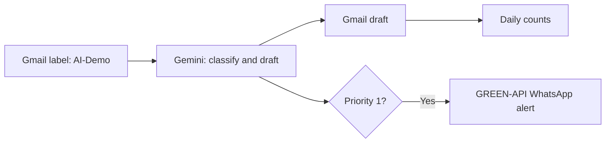

# AI Email Assistant (Google Apps Script)

A small automation demo I built to triage selected Gmail messages. Google Apps Script reads messages in a dedicated `AI-Demo` label, asks Gemini for a priority, summary, and editable reply, creates a **Gmail draft**, and sends a **WhatsApp alert through GREEN-API only for priority 1**. A separate daily WhatsApp message summarizes processed messages. The script does not send email replies.

## What I implemented

- A three-level priority rubric: **P1** for concrete near-term deadlines or critical issues, **P2** for actionable messages without an immediate deadline, **P3** for routine or informational mail.
- Structured JSON output from Gemini, followed by validation before creating the draft.
- An `AI-Demo` label that limits which Gmail threads the script examines; it skips drafts and messages sent from the account's own addresses.
- Script locking and per-message state in Script Properties so scheduled runs can resume unfinished work and avoid routinely recreating drafts.
- Optional one-minute inbox trigger and a daily summary trigger around 17:00 Europe/Berlin.

This is an interview prototype. The model's priority and proposed reply require human review. A WhatsApp request accepted just before state is saved could be repeated after a failure. The script searches up to 50 labeled threads and processes at most 15 messages per run. It stores summaries, draft IDs, sender strings, and dates in Script Properties; plan retention and privacy accordingly.

## Setup

1. Create a standalone Google Apps Script project at [script.google.com](https://script.google.com/) and paste `Code.gs` into its editor.
2. In the Gmail account used for the demo, create a label named **`AI-Demo`**. Apply it only to messages you want processed.
3. In **Project Settings → Script Properties**, add the following values for your own accounts:

   | Property | Meaning |
   | --- | --- |
   | `GEMINI_API_KEY` | Gemini API key |
   | `GREEN_API_URL` | GREEN-API base URL for your instance |
   | `GREEN_INSTANCE_ID` | GREEN-API instance ID |
   | `GREEN_API_TOKEN` | GREEN-API token |
   | `GREEN_CHAT_ID` | Destination WhatsApp chat ID |

4. In Apps Script, choose `processInbox` and click **Run**. Approve the Google permissions requested for your account. Check that the selected message has a Gmail draft; a P1 message also sends a WhatsApp alert.
5. After manual testing, run `installTriggers` once if you want scheduled processing. This installs an inbox check every minute and a daily summary around 17:00 Berlin time. Apps Script time triggers run approximately, rather than at an exact minute. Remove those triggers in Apps Script when you no longer want the demo running.

**Important:** `testConnections()` calls Gemini with a fictional email **and sends one real WhatsApp test message**. `demoDailySummary()` also sends a real WhatsApp message. `processInbox()` creates real Gmail drafts for selected messages; it never sends an email. `sendDailySummary()` sends the daily WhatsApp summary.

## Public repository boundaries

The code reads credentials from Script Properties. Do not put keys, tokens, chat IDs, real email contents, exported Gmail data, or account screenshots in this repository. Message contents are sent to Gemini for analysis, and P1 sender/summary information is sent through GREEN-API to the configured WhatsApp destination. Use consented demo messages or synthetic examples when showing this project.

## Example classification

For the fictional message “Please confirm by 16:00 today that you received our request,” Gemini can return a P1 classification, a short explanation, and a suggested acknowledgement. The reply is saved as a draft for review.
